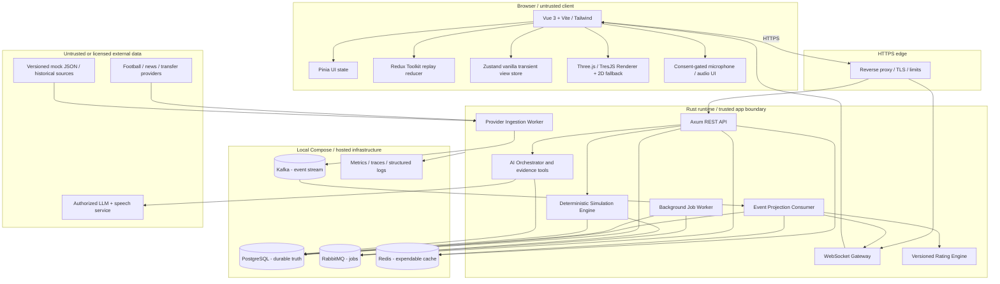
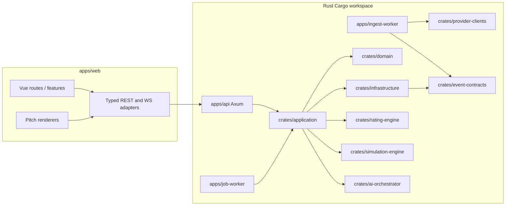
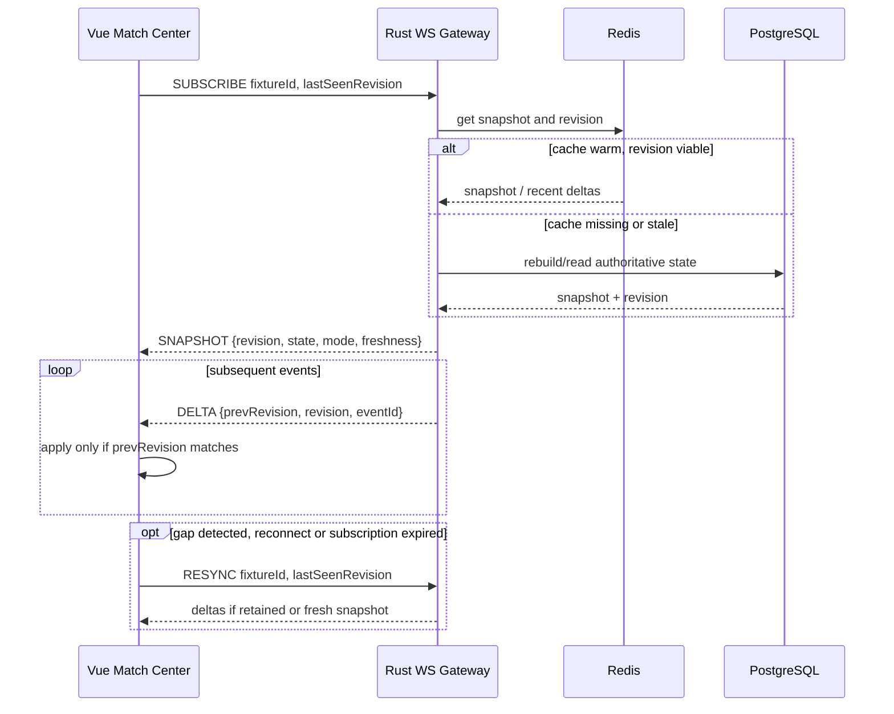
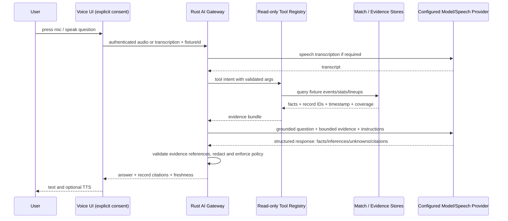
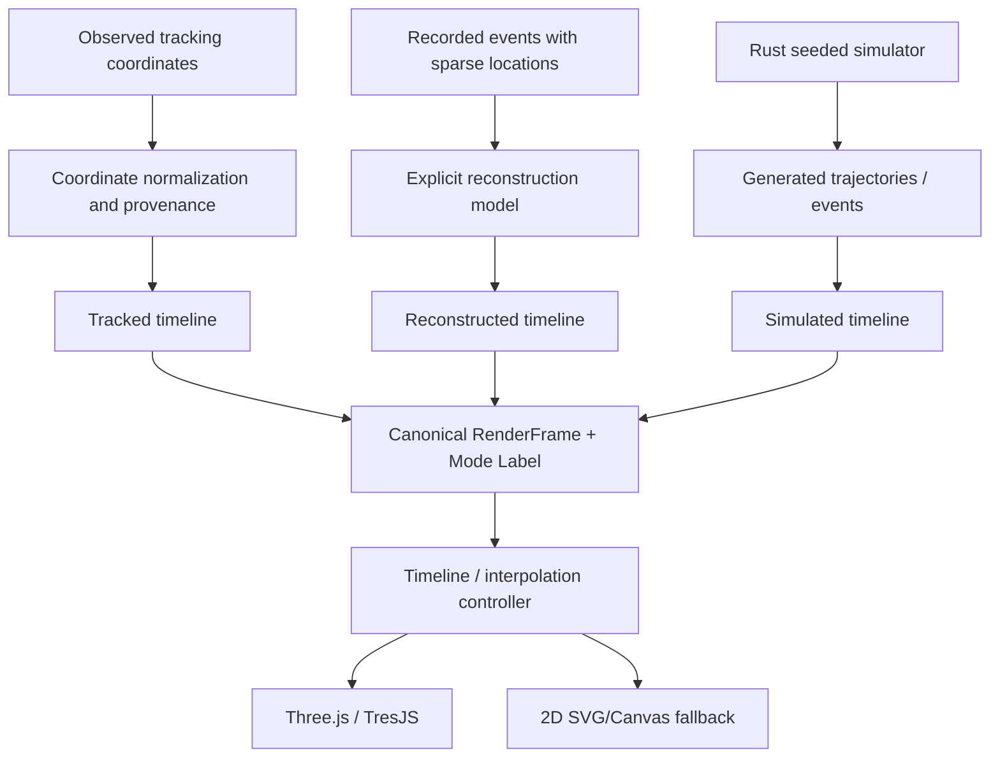
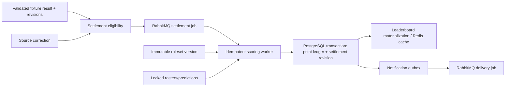
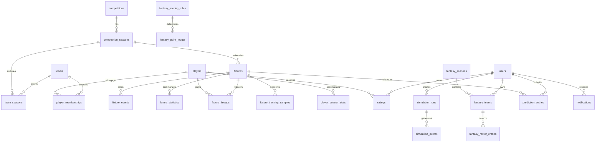

# PitchPulse — System Architecture & Engineering Contract

> **Repository:** `pitchpulse-football-intelligence`  
> **Product:** PitchPulse — *The Game, Decoded.*  
> **Status:** Target architecture for a greenfield implementation; **not evidence that any component is implemented**.  
> **Companion:** [`ROADMAP.md`](./ROADMAP.md), the 24-step execution and acceptance plan.  
> **Audience:** Codex, AI coding agents, Rust/Vue engineers, systems reviewers, operations engineers.  
> **Contract:** This document establishes boundaries, invariants, data contracts, trust constraints, and implementation guidance. Code and verified tests are the source of truth for *what is actually implemented*.

## Implemented status — Step 02

The target contract below is preserved. The current implementation now contains a Cargo workspace with the Axum API, three worker bootstrap executables, and domain/application/infrastructure/shared libraries; a Vue 3 + TypeScript + Vite + Tailwind + Router + Pinia client; and local Compose services for PostgreSQL, Redis, Kafka and RabbitMQ.

The working slice is the browser system-status page calling `/api/v1/system` and `/api/v1/health/ready`, backed by a real SQLx PostgreSQL query. Liveness aliases include `/health`. Worker business processing, football schemas, auth, real/mock fixture ingestion and event delivery remain later milestones.

See [ADR-0001](adr/0001-step-02-workspace.md) for reconciliation of the roadmap's four executable targets with the initial three-executable deployment sketch; [local development](runbooks/LOCAL_DEVELOPMENT.md), [HTTP contracts](api/health.md) and [editable implemented diagram](architecture/local-development.mmd) describe current behavior. The remaining diagrams are target designs.

---

## 0. Non-negotiable instructions for Codex and developers

1. **Read `ROADMAP.md` and this file before modifications.** Inspect the actual repo, Git status, manifests, schema migrations, current decisions and tests. Never infer implementation from a target diagram.
2. **Work from the first incomplete roadmap step** unless explicitly directed otherwise. Implement vertical slices (contracts → database → service → route/event → UI → tests → docs). Do not build an entire speculative microservice landscape up front.
3. **Keep the core stack:** Rust/Axum/Tokio/SQLx/PostgreSQL, Vue 3/TypeScript/Vite/Tailwind, Three.js/TresJS, Kafka, RabbitMQ, Redis and WebSockets; AI integration is configurable. Pin tested versions, do not blindly copy versions from this document.
4. **Mocks are first-class, not hidden shortcuts.** Every provider must implement the same canonical interface. Real data, recorded data, reconstructed motion, simulation and test mock data remain distinguishable in API contracts, UI labels, event histories and analysis.
5. **Do not invent facts.** The AI cannot claim an unsourced foul, player location, xG, transfer, injury, causal tactical explanation or real-time ball trajectory. Never disguise interpolation as measurement.
6. **Secure by default.** No credentials in Git or client bundles; server-side source access; use TLS, authentication, authorization, secret rotation, safe input processing and privacy-aware logging. Do not expose the Sportmonks token shared in earlier discussions.
7. **Eventual consistency is explicit.** PostgreSQL is the durable domain system of record; Kafka is the event transport/replay log (subject to configured retention); Redis is disposable read state; RabbitMQ carries jobs, not the canonical match-event history. No exactly-once end-to-end claims.
8. **Do not silently change architectural decisions.** Record important deviations in `docs/adr/` with rationale, migration impact, alternatives and tradeoffs. Update diagrams and contracts with the code.
9. **Report verified progress:** changed files, commands/test results, migration status, demo path, data mode, blockers and next roadmap step. A checkbox is completed only when its acceptance criteria pass.
10. **Never promise background progress** beyond an actual running execution session. Leave precise continuation notes if unable to finish.

### Architecture priorities, in order

Correctness and provenance → trustworthy user experience → testability → operational simplicity → security/privacy → maintainability → performance/low latency → controlled scalability → polish. A performant misleading ball animation is worse than an honest static pitch.

---

## 1. Scope and domain boundaries

PitchPulse consists of six differentiated product experiences and supporting platform functions:

| Domain | Core capabilities | Truth boundary |
|---|---|---|
| Football catalogue | Competitions, seasons, fixtures, standings, teams, player profiles, match statistics | Normalized and attributed external/historical/mock records |
| Live Match Center | Scores, events, lineup, match timeline, subscribed updates, pitch visualization | Event history + materialized match state; time and coverage explicit |
| Football Intelligence | Position-aware ratings, player rankings, AI analyst, scouting, tactical lab, comparisons | Deterministic analytics + grounded explanations; confidence/coverage displayed |
| Dream Match Simulator | Cross-era squad builder, formations, tactics, stochastic Rust engine, 3D replay | Synthetic match simulation; reproducible and never mistaken for actual history |
| Two Fantasy modes | Season-long roster fantasy; matchday prediction fantasy; leagues and leaderboards | Locked rules, entry deadlines, authoritative settlement ledger |
| Content + community | News, transfers, follow/favourites, discussions, notifications | Source attributions, moderation and user privacy |

**Out of scope at initial launch:** broadcast video rights; invented continuous physical tracking; wagering; bookmaker-style odds; unsupported scouting valuations; expensive distributed service decomposition before measured need.

### Supported modes are not interchangeable

`LIVE_OBSERVED` = real authorized time-stamped observations; `HISTORICAL_OBSERVED` = historical source observations; `EVENT_RECONSTRUCTION` = model-generated paths between sparse recorded events; `SIMULATION` = hypothetical engine output; `MOCK` = synthetic development fixture data. `INTERPOLATED` is a *rendering method*, not independent evidence of an observation. A live mock stream is still `MOCK`, not `LIVE_OBSERVED`.

### Architectural quality objectives (initial design targets; validate before SLAs)

- REST p95 target under 300 ms for cached list/detail reads **within the application**, excluding slow third-party refreshes; measure rather than assert.
- WebSocket: target updates pushed within 1 second **after normalized ingestion**, not within 1 second of the on-field event; show upstream lag separately.
- 3D: aim for smooth 60 FPS on capable desktop; adaptive resolution and 2D canvas/SVG fallback on mobile/reduced-power devices.
- Replays deterministic and recoverable; no data loss from the client reconnect path when the server retains events.
- Each provider-dependent page handles missing capabilities, stale data, disconnected state, no fixtures and revoked entitlements.
- Architectural decisions should support local development on a single workstation and modular container deployment.

---

## 2. Detailed architecture diagrams

### 2.1 Overall component / trust boundary diagram



**Diagram rule:** arrows indicate *logical* communication; do not assume a transaction across PostgreSQL, Kafka, Redis and RabbitMQ. Implement durable outbox/inbox and compensation where necessary.

### 2.2 Repository/Cargo and deployable units



Deploy **API**, **ingestion worker**, **background worker** as three Rust executables initially. Shared crates are libraries, not network services. Additional services only via an ADR with clear scaling or fault-isolation evidence.

### 2.3 Provider ingestion, ordering and projections

```mermaid
sequenceDiagram
  autonumber
  participant P as Provider / Mock Replay
  participant I as Rust Ingestor
  participant K as Kafka
  participant C as Projection Consumer
  participant DB as PostgreSQL
  participant R as Redis
  participant W as WS Gateway
  participant V as Vue Client
  P->>I: poll/stream raw change
  I->>I: authenticate, normalize, validate, provenance
  I->>I: derive provider event key + version
  I->>K: publish canonical event (fixture key)
  K-->>C: at-least-once delivery
  C->>DB: transactional inbox dedupe + event/upsert + fixture revision
  DB-->>C: committed revision N
  C->>R: update read state if revision newer (repairable)
  C->>W: publish lightweight change/snapshot pointer
  W-->>V: revision N delta / event
  V->>V: apply if contiguous, otherwise resync
  Note over V,DB: Replay/correction may revise prior state; client fetches authoritative snapshot as needed.
```

**No fake exactly-once:** Kafka may redeliver; consumers use idempotent writes. A provider correction is a *new version of a logical event*, not an unrelated additional goal. Tie event revision and persistence in one PostgreSQL transaction; Redis/WS updates are recoverable side effects. Consider transactional outbox for database-to-broker publication.

### 2.4 WebSocket reconnect and snapshot reconciliation



### 2.5 AI voice Q&A and evidence boundary



LLM output is not a source of football facts. A provider lacking the fouling player's identity must yield “not recorded”; no speculative identification. Audio retention and consent must be explicit.

### 2.6 One renderer, three pipelines



No player/broadcast video required. Sparse event reconstruction must indicate uncertainty; player markers in a hypothetical game are simulation entities, not observed tracking.

### 2.7 Fantasy settlement and correction pipeline



Treat rescoring as an **adjustment ledger**, not silent mutation of previously issued points. Preserve timestamps of rules, lineup lock, source version and scoring decision.

### 2.8 Deployment boundaries

```mermaid
flowchart TB
  USER[Browser] --> CDN[CDN / HTTPS static Vue]
  USER --> LB[HTTPS reverse proxy / load balancer]
  LB --> API[Axum API replicas]
  LB --> WS[Axum WS gateway replicas]
  subgraph PRIV[Private application network]
    ING[Ingest worker]
    WORK[Job worker]
    PG[(PostgreSQL + backups)]
    RED[(Redis)]
    K[(Kafka broker(s))]
    MQ[(RabbitMQ)]
    METRICS[Observability stack]
  end
  API --> PG
  API --> RED
  API --> MQ
  WS --> RED
  ING --> K
  K --> WORK
  WORK --> PG
  WORK --> RED
  API --> METRICS
  WS --> METRICS
  ING --> METRICS
  WORK --> METRICS
```

Keep databases and brokers off the public internet. Host the Vue static app independently; deploy long-lived Rust WebSockets and workers on container-capable infrastructure. Production Kafka is operationally nontrivial; prefer a compatible managed offering if practical and affordable. Docker Compose is the local development baseline, **not** an HA production topology.

---

## 3. Technology ownership and state-management rules

| Component | Owns | Must not own |
|---|---|---|
| PostgreSQL | Durable users, teams, fixtures, event history, projections, scoring ledgers, simulation saves | Transient render frames at 60 Hz unless retention expressly required |
| Kafka | Ordered-per-key normalized event delivery, retained replay window, independent consumers | User authentication truth, endless archival by assumption, background jobs that need task acknowledgements |
| RabbitMQ | Point-to-point asynchronous jobs, retries, DLQs, concurrency | Primary football event history, long-term analytics truth |
| Redis | Live match state, recent deltas, rate limits, locks with bounded lease, short-lived leaderboards | Sole copy of match results, fantasy scores or user content |
| Axum REST | Authentication, validation, transactional APIs, queries, orchestration | Rendering, long blocking simulation work inside request threads |
| Rust ingestion | Provider polling/webhooks, normalization, source revisions, Kafka publish | Business-facing Vue coupling |
| Rust simulation engine | Seeded hypothetical events and trajectories | Real-match provenance or ground truth |
| AI orchestrator | Typed tool calls, evidence bundles, guarded model communication | Making unsupported tactical claims or replacing deterministic ratings |
| Pinia | Authentication view state, preferences, regular UI workflow | 60 FPS render positions, duplicated replay event log |
| Redux Toolkit (framework-neutral) | Serializable replay action/reducer model **if justified** | Normal Vue app state already owned by Pinia |
| Zustand `vanilla` + Vue adapter | Ephemeral high-frequency camera/formation interaction **if justified** | Persistent domain state and data contracts |
| Three.js/TresJS | Rendering and interpolation of canonical frame input | Deciding whether event data is true or simulated |

**Avoid unnecessary dual stores.** Step 11 must document the measurable need and ownership boundaries before adding Redux/Zustand. Their vanilla/framework-neutral APIs can be used without React, but Vue requires explicit subscription/unsubscription adapters. Reconcile with the existing roadmap if tests show a simpler Pinia + local composable approach is materially safer.

### Suggested frontend modules

`src/app` (router/providers), `src/design` (tokens/primitives), `src/features/matches`, `competitions`, `clubs`, `players`, `rankings`, `scout`, `ai-analyst`, `simulation`, `fantasy-season`, `fantasy-predictions`, `news`, `transfers`, `profile`; `src/data/api`, `src/data/ws`, `src/visualization/pitch`, `src/state`. Feature modules should own their pages, components, composables, API adapters and tests. Avoid single giant components.

---

## 4. Rust workspace and module architecture

Target structure (create incrementally during roadmap steps; these folders are not all required on day one):

```text
pitchpulse-football-intelligence/
├── ROADMAP.md
├── ARCHITECTURE.md
├── README.md
├── Cargo.toml                         # workspace
├── pnpm-workspace.yaml                # if needed
├── .env.example
├── docker-compose.yml
├── apps/
│   ├── web/                           # Vue 3 / TypeScript / Vite
│   │   └── src/{app,features,design,data,state,visualization,assets}/
│   ├── api/                           # Axum REST, auth, websocket
│   │   └── src/{main.rs,config,api,middleware,bootstrap}/
│   ├── ingest-worker/                 # provider polling and normalization
│   └── job-worker/                    # RabbitMQ / asynchronous work
├── crates/
│   ├── domain/                        # domain objects, invariants, identifiers
│   ├── application/                   # use cases, transaction boundaries, traits
│   ├── infrastructure/                # SQLx repos, Redis, broker adapters
│   ├── provider-clients/              # mock + real provider implementations
│   ├── event-contracts/              # versioned events and serialization
│   ├── rating-engine/                # pure versioned scoring functions
│   ├── simulation-engine/            # pure seeded core + generated events
│   └── ai-orchestrator/               # typed retrieval tools, LLM providers
├── database/{migrations,seeds}/
├── data/mock/{v1,fixtures,events,tracking,statistics,news,transfers}/
├── docs/
│   ├── adr/                           # decision records
│   ├── diagrams/                      # editable detailed Mermaid diagrams
│   ├── api/                           # OpenAPI / contracts
│   ├── data-sources/                  # provider capability and license matrix
│   ├── scoring-models/               # rating and fantasy rule versions
│   ├── runbooks/                      # broker/database/incident operations
│   ├── BLOCKERS.md
│   └── DECISIONS.md
├── infra/{docker,kafka,rabbitmq,otel}/
└── .github/workflows/
```

**Ports and adapters:** domain/core has no framework, SQLx, Kafka, Redis, UI, or LLM dependencies. Application crate defines traits (`FixtureRepository`, `MatchEventPublisher`, `FixtureDataProvider`, `JobScheduler`, `Clock`, `ModelClient`). Infrastructure implements traits. HTTP handlers depend on application services, not database-specific models. Prefer explicit constructors and `Arc<dyn Trait + Send + Sync>` only when useful; avoid abstractions that serve no test or decoupling purpose.

**Synchronous transaction boundary:** one PostgreSQL transaction per aggregate mutation where possible. For domain changes requiring Kafka publish, prefer an outbox table written in the same transaction and a reliable publisher that marks dispatch progress. Repeated delivery is safe via idempotency keys.

---

## 5. Data contracts: canonical source of truth

### 5.1 Shared envelope

Every normalized externally sourced or mock event uses a versioned envelope:

```json
{
  "schema_version": 1,
  "event_id": "evt_provider_fixture123_goal456_rev2",
  "event_type": "match.event.upserted",
  "aggregate_type": "fixture",
  "aggregate_id": "fixture-123",
  "aggregate_revision": 42,
  "occurred_at": "2026-10-25T20:12:00Z",
  "observed_at": "2026-10-25T20:12:14Z",
  "ingested_at": "2026-10-25T20:12:15Z",
  "source": {
    "provider": "mock",
    "mode": "MOCK",
    "external_id": "goal456",
    "source_revision": 2,
    "capabilities": ["events", "score"]
  },
  "payload": {
    "kind": "GOAL",
    "minute": 72,
    "second": 15,
    "period": "SECOND_HALF",
    "team_id": "team-home",
    "player_id": "player-9",
    "assist_player_id": null,
    "status": "CONFIRMED"
  }
}
```

**Example is synthetic** and must never be presented as a real score/event. Contract decisions:

- `event_id` = unique occurrence/revision message ID; `source.external_id` + provider + fixture identify logical event; `source_revision` models correction.
- `aggregate_revision` must be assigned monotonically by the projection/state owner, not trusted from a vendor; other producers may use a nullable preprojection revision.
- Timestamps are UTC, RFC 3339, with provider local-time interpretation recorded separately if necessary. Keep event time, observation receipt time, processing time apart.
- `event_type` and `schema_version` are validated; unknown schema versions are quarantined, not guessed.
- No mutable cached state serialized as if it were a unique observed event.
- Use explicit optional fields, not misleading fabricated zero values.

### 5.2 Tracking sample

```json
{
  "schema_version": 1,
  "fixture_id": "fixture-123",
  "sample_id": "sample-1887",
  "period": "SECOND_HALF",
  "match_clock_ms": 4215000,
  "x_normalized": 0.62,
  "y_normalized": 0.41,
  "orientation": "HOME_ATTACKS_RIGHT",
  "source": {"provider": "mock", "mode": "MOCK", "measured": false},
  "sampled_at": "2026-10-25T20:12:00Z",
  "received_at": "2026-10-25T20:12:15Z"
}
```

Coordinates are `0..1` along canonical pitch length and width. Ingestor must track original coordinate ranges, axes, whether home/away attacks left/right by period, units, and whether coordinates refer to ball or event location. Null tracking is represented as *missing*, not zero. If source provides only 6–12 sparse samples per minute, renderer must not claim complete tracking. Handle halftime resets, stoppage time and extra time with explicit period-relative and match-relative clocks.

### 5.3 Frame contract between data and renderer

```ts
export type DataMode =
  | 'LIVE_OBSERVED'
  | 'HISTORICAL_OBSERVED'
  | 'EVENT_RECONSTRUCTION'
  | 'SIMULATION'
  | 'MOCK';

export interface PitchRenderFrame {
  fixtureOrSimulationId: string;
  mode: DataMode;
  clockMs: number;
  ball: { x: number; y: number } | null;
  playerMarkers?: Array<{ id: string; teamId: string; x: number; y: number }>;
  interpolation: 'none' | 'linear' | 'spline' | 'simulation';
  observedSampleIds: string[];
  sourceTimestamp?: string;
  sourceAgeMs?: number;
  confidence?: 'observed' | 'approximate' | 'hypothetical' | 'unknown';
}
```

Business logic decides `mode`; renderer **must not** change it. Avoid overshoot and impossible ball paths with conservative interpolation and sparse-data gap caps. Expose “data unavailable” where necessary.

### 5.4 Provider capability / trust contract

```rust
// Interface sketch; adapt exact signatures to tested crates and domain design.
#[async_trait::async_trait]
pub trait FootballDataProvider: Send + Sync {
    async fn fixtures(&self, query: FixtureQuery) -> Result<Vec<Fixture>, ProviderError>;
    async fn fixture_events(&self, fixture: FixtureId) -> Result<ProviderBatch<MatchEvent>, ProviderError>;
    async fn fixture_stats(&self, fixture: FixtureId) -> Result<ProviderBatch<MatchStatistics>, ProviderError>;
    async fn ball_tracking(&self, fixture: FixtureId) -> Result<ProviderBatch<TrackingPoint>, ProviderError>;
    async fn capabilities(&self, fixture: FixtureId) -> Result<ProviderCapabilities, ProviderError>;
}
```

`ProviderBatch` must include mode, external provider, fetched time, historical/data timestamp, coverage, sample count, latency and license/attribution metadata. Providers must return typed `UnsupportedCapability` or `AccessDenied` errors; never synthesize data behind a “live” interface. Client-facing API should report `available`, `unavailable`, `stale`, `restricted` and `mock` statuses distinctly.

### 5.5 Source and coverage matrix

Track real availability by **provider × competition × fixture × plan × feature**. Supported examples: fixtures, match result, lineups, goals, cards, possession, xG, event location, tracking, player stats, transfer fees, news usage. No hardcoded claim that a subscription provides tracking for every match. Document limitations and license/retention/AI-use conditions in `docs/data-sources/` before production ingestion.

---

## 6. PostgreSQL architecture

Use SQLx typed queries and migrations. Favor normalized stable IDs and temporal membership rather than copying mutable player/team names into every relational record. Store original vendor IDs in separate mapping rows.

### 6.1 Aggregate/entity model (logical ERD)



This is a **logical** diagram, not complete physical SQL. Generate full per-domain ERDs and migrations while implementing their roadmap steps.

### 6.2 Table groups and boundaries

| Domain | Initial tables / responsibilities |
|---|---|
| Identity | users, sessions, user_preferences, user_favourite_teams, user_favourite_players |
| Football catalogue | competitions, competition_seasons, teams, team_seasons, players, player_memberships, player_season_stats, provider_id_mappings |
| Fixtures | fixtures, fixture_periods, fixture_events, event_revisions, fixture_lineups, fixture_statistics, fixture_tracking_samples |
| Event control | consumer_inbox, outbox_messages, ingestion_cursors, provider_capability_records, event_projection_versions |
| Ratings | rating_model_versions, match_player_ratings, season_player_ratings, rating_factors |
| Simulation | simulation_rosters, simulation_player_snapshots, simulation_tactics, simulation_runs, simulation_events, simulation_results |
| Fantasy season | fantasy_seasons, fantasy_leagues, league_memberships, fantasy_teams, roster_entries, locked_lineups, fantasy_scoring_rules, fantasy_point_ledger |
| Prediction fantasy | prediction_contests, entries, locked_predictions, prediction_settlements, point_ledger |
| Content | news_source_refs, article_metadata, transfers, transfer_evidence, discussions, reports, notifications |

### 6.3 Physical data rules

- Primary IDs: UUID (or consistent typed IDs), timestamps `timestamptz`, explicit constraints. `UNIQUE(provider, external_id, entity_type)` for provider mappings.
- `fixture_events`: stable logical event key, latest revision, event source, status and payload, with immutable revision history or change journal.
- `fixture_tracking_samples`: partition/index by fixture and match clock, apply retention and license constraints. Never ingest raw full-resolution tracking if not entitled.
- Fantasy ledger: immutable point entries with deterministic idempotency key (`competition/fixture/user/ruleset/source_revision/kind`); correction creates compensating entries.
- Ruleset versions and player-season snapshots are immutable once associated with settled games/simulations.
- Optimistic concurrency using revisions for mutable collaborative/user entities; transactions for monetary-like **point** accuracy even though no betting/money is involved.
- Time: retain kickoff in UTC plus original event timezone when relevant; use server time to lock predictions.
- Avoid a monolithic `data JSONB` table; JSONB is appropriate only for evolving vendor payload snapshots/auditable extras with known retention.
- Privacy: separate personal account data from public leaderboards; deletion/anonymization policy must preserve competition audit integrity without exposing personal data.

### 6.4 Index baseline

Create verified indexes for fixture `(competition_season_id, kickoff_at)`, event `(fixture_id, period, match_clock_ms)`, tracking `(fixture_id, period, match_clock_ms)`, player season `(player_id, season_id)`, ranking `(model_version, season_id, position, score DESC)`, fantasy ledger `(team_id, fixture_id, revision)`, prediction lock `(fixture_id, user_id)`, consumer inbox `(consumer_id, event_id)`, provider map `(provider, external_entity_type, external_id)`. Validate query plans at scale; don't add indexes blindly.

---

## 7. Kafka and RabbitMQ: precise delivery semantics

### 7.1 Kafka: event facts + replay

Topic taxonomy (proposals; implement as domains materialize):

- `football.fixture.lifecycle.v1`
- `football.fixture.events.v1`
- `football.fixture.statistics.v1`
- `football.fixture.tracking.v1`
- `football.player.statistics.v1`
- `football.rating.recalculated.v1`
- `football.transfers.updated.v1`
- `football.news.metadata.v1`
- `football.simulation.events.v1` (optional; high-rate events may be better served as durable simulation logs + WS playback)

**Partition key:** stable fixture ID for match streams. This ensures per-partition ordering of delivered messages; it does **not** guarantee input happened in source-time order or that updates across topics are atomic. Reorder/repair using domain revisions and original event timestamps.

**Consumer groups:** projection-writer; live-read-model; rating-calculator; fantasy-trigger; alert-trigger; analytical-history. Give each an idempotent inbox keyed by `(consumer,event_id)`; commit offsets only after durable outcome or recoverable no-op. Backpressure and dead-letter quarantine require operator visibility. Do not use Kafka as a payment or fantasy ledger.

**Publication consistency:** provider worker may publish to Kafka after validating and checkpoint only after broker acknowledgment. If persisting updates first in PostgreSQL, employ outbox dispatch. Document chosen ingestion recovery strategy. Never rely on a single in-memory cursor.

### 7.2 RabbitMQ: bounded jobs

Recommended exchanges/queues:

| Exchange / queue | Job types | Reliability requirement |
|---|---|---|
| `jobs.ai` | Match summary, scouting report, long-form analysis | Rate limits, dedupe and short retention of sensitive prompts |
| `jobs.simulation` | Seeded Rust simulation execution | Idempotent run ID, lease/timeout, saved checkpoints or restart |
| `jobs.fantasy` | Settlement/reconciliation | Durable, revision-aware and audit ledgers |
| `jobs.notifications` | Email/push/in-app delivery | At-least-once, per-recipient idempotency, mute preferences |
| `jobs.content` | Feed classification/transfer source update | Respect source rights and attribution |

Use durable queues, publisher confirms, acknowledgements **after** committed side effects, retries with backoff, bounded attempts, dedicated dead-letter queues, poison-message inspection and worker resource limits. No unbounded requeue loops.

### 7.3 Redis and WebSocket contract

Redis keys must be namespaced and TTL-controlled: e.g. `fixture:{id}:snapshot`, `fixture:{id}:recent-revisions`, `ranking:{season}:{modelVersion}`, `ratelimit:{actor}:{route}`. Do not store unencrypted long-lived raw voice audio or secrets. A Redis flush/restart must not erase critical truth; rebuild projections from PostgreSQL/Kafka as retained.

WebSocket message shapes:

```json
{ "type": "snapshot", "fixture_id": "fixture-123", "revision": 42, "mode": "MOCK", "data": {}, "server_sent_at": "2026-10-25T20:12:16Z" }
{ "type": "delta", "fixture_id": "fixture-123", "prev_revision": 42, "revision": 43, "event_id": "evt-43", "change": {} }
{ "type": "resync_required", "fixture_id": "fixture-123", "reason": "revision_gap" }
```

Require schema version, message type validation, authentication/authorization for protected channels, connection heartbeats, max message size, per-client send-buffer limits, reconnect backoff and snapshot fallback. Client must compare revisions; silent dropped deltas are unacceptable. Never broadcast a user's private fantasy or AI context to public match channels.

---

## 8. REST API and interface conventions

Base path `/api/v1`. Use consistent plural resource names and stable identifiers. Use OpenAPI generated/maintained with actual handler contracts; implement compatible schema changes or version endpoints. Paginate potentially large lists using cursor/keyset where appropriate. Validate payload size and query bounds.

### 8.1 Representative endpoints

```text
GET    /api/v1/health/live
GET    /api/v1/health/ready
GET    /api/v1/competitions
GET    /api/v1/competitions/{id}/seasons/{seasonId}/standings
GET    /api/v1/teams/{id}
GET    /api/v1/players/{id}
GET    /api/v1/fixtures?from=&to=&competition=&status=
GET    /api/v1/fixtures/{id}
GET    /api/v1/fixtures/{id}/events
GET    /api/v1/fixtures/{id}/statistics
GET    /api/v1/fixtures/{id}/lineups
GET    /api/v1/fixtures/{id}/tracking
GET    /api/v1/fixtures/{id}/capabilities
GET    /api/v1/rankings/players?season=&position=&minimumMinutes=
POST   /api/v1/ai/match-questions
POST   /api/v1/ai/scout
POST   /api/v1/simulations
GET    /api/v1/simulations/{id}
GET    /api/v1/simulations/{id}/events
POST   /api/v1/fantasy/seasons/{id}/teams
POST   /api/v1/prediction-contests/{id}/entries
GET    /api/v1/fantasy/leaderboards/{id}
GET    /api/v1/news
GET    /api/v1/transfers
GET    /api/v1/me
PUT    /api/v1/me
GET    /ws/v1/fixtures/{id}
```

Use named HTTP statuses (e.g. 400 invalid input, 401 unauthenticated, 403 unauthorized, 404 resource absent, 409 conflict/revision mismatch, 422 domain validation, 429 throttled, 503 upstream unavailable). A missing capability is not necessarily 404; return data availability metadata clearly.

### 8.2 Error envelope

```json
{
  "error": {
    "code": "TRACKING_NOT_AVAILABLE",
    "message": "Ball tracking is unavailable for this fixture and provider access level.",
    "request_id": "req-123",
    "retryable": false,
    "details": {"fixture_id": "fixture-123", "capability": "ball_coordinates"}
  }
}
```

Do not return vendor tokens, SQL details, stack traces or sensitive provider responses. Implement request IDs and safe structured logging. Public APIs should include explicit provenance, fresh/stale status and source attribution for provider-backed statistics.

### 8.3 Contract-first workflow

For a vertical feature: declare API and event schema → design indexes/migration → write domain/service tests → implement Rust → implement typed frontend client → handle loading/error/empty/stale/missing coverage → integration/e2e tests → document in `docs/api`.

---

## 9. Three.js pitch, animation and simulation boundaries

### 9.1 Scene graph

```text
PitchScene
├── PitchSurface / field markings
├── Lighting / minimal stadium ambience
├── Goals
├── BallMesh + optional path trail
├── TacticalMarkerLayer (only when mode supports markers)
├── EventAnnotations (goals, fouls, shots)
├── CameraController (top-down / isometric)
├── TimelineController (frame clock, pause, seek, speed)
└── CoverageOverlay (source, lag, observed vs reconstructed vs simulated)
```

The ball marker must not imply continuous tracking if data is sparse. Use source sampling density, interpolation gaps, bounds checks, period/orientation normalizations and a maximum extrapolation duration. If samples stop, freeze/fade and indicate stale state; don't invent a path. Event-based reconstructions must show an explicit badge and uncertainty band rather than presenting them as live truth.

### 9.2 Rendering and interaction performance

- Use requestAnimationFrame and scene-local state for camera/position changes; avoid re-rendering the Vue component tree every frame.
- Use `devicePixelRatio` cap, level of detail, dynamic FPS/quality degradation and unmount cleanup.
- Set a performance budget and test slow hardware/mobile; 2D view is a fully supported product path.
- User can pause, scrub, switch speeds, access keyboard equivalents and disable motion. Cursor effects remain restrained and are never attached to a floating football.
- Display match clock in **match time**, not wall-clock receipt time. Preserve source lag separately.

### 9.3 Rust simulation engine is a pure domain kernel

Simulation input:

```text
SimulationConfig {
  engine_version,
  random_seed,
  selected_player_season_snapshots,
  squads_and_bench,
  formations,
  roles,
  tactics,
  substitution_rules,
  match_rules,
  scenario_parameters
}
```

Simulation output: immutable saved event log, movement frames/paths where generated, post-match summary and traceable model version. Given the same input + engine version + seed, results should reproduce in CI and different machines (control PRNG and floating-point nondeterminism or pin expected tolerances). Every simulated metric is marked **hypothetical**. LLM may narrate or explain resulting events but must not determine goals/winners invisibly.

Keep the **match replay loader** separate from the **simulation event generator**. Share a renderer and normalized playback controls, not provenance or statistical semantics.

### 9.4 Rating model

Build position-specific, versioned, explainable models. Separate: objective measurable input, normalized contribution, role-dependent weights, time/usage adjustments, sample-size shrinkage, confidence/coverage and final public score. A ten-minute player may be better in a given performance but must receive appropriate uncertainty; a striker's three goals remain meaningful even with few passes. Missing xG/pressing must be missing/unknown, not silently treated as zero. Persist breakdown and model version. Test against representative historical and mock edge cases, not only agreement with an opaque third-party rating.

---

## 10. AI architecture: grounded, bounded, accountable

### 10.1 Read-only match analysis tools

Typed tools with validated arguments:

`get_fixture_snapshot`, `get_event_timeline`, `get_goal_sequence`, `get_penalty_incident`, `get_lineup_and_substitutions`, `get_team_match_stats`, `get_player_match_stats`, `get_provider_coverage`, `compare_time_windows`, `search_player_seasons`, `get_simulation_event_log`.

Each tool response returns source IDs, event IDs, fetched time, original time, data mode and capability coverage. AI responses structure: `answer`, `observed_facts[]`, `inferences[]`, `unknowns[]`, `evidence_refs[]`, `data_freshness`, `data_mode`. Validate that citations refer to tool-returned records. Never allow unvalidated generated SQL or arbitrary external URLs from model responses.

### 10.2 Voice pipeline and latency

Implement explicit consent for microphone activation; provide text fallback. For voice use the supported speech-to-text/realtime platform through secure short-lived credentials or backend relay (depending on provider), then grounded tool retrieval and optionally text-to-speech. Use bounded audio frames, streaming when feasible, user-visible microphone state and interruption/cancellation. Do not record/store raw audio by default. Put strict cost, model-token and time limits on requests. Voice answering should gracefully degrade to text when audio services fail.

### 10.3 RAG and licensing

RAG may index licensed/authorized match records, original app data, verified user-supplied text or permitted public material. Do **not** assume all provider text, news articles and match-derived data are licensed for embedding or sending to a model. Track provenance and permitted-use policy by source. Prefer retrieval of canonical structured event rows over embeddings for live factual questions. Use vector indexing only when semantic search truly requires it and license permits; avoid deploying a vector DB solely because RAG is mentioned.

### 10.4 Scouting, tactical interpretation and simulation

- **Scouting:** LLM parses natural-language filters into a constrained schema; Rust/SQL runs validated statistics queries; deterministic ranking generates shortlist; model explains evidence.
- **Tactical analysis:** Clearly separate measured possession/territory and event patterns from causal interpretations. Where full player tracking unavailable, say so.
- **Simulation explanation:** Only read simulated output and player snapshots; never call it a historical result.
- **Prompt injection:** Treat provider text, user reviews and news summaries as untrusted data. Restrict tool permissions, schema, output, network and source scope.

---

## 11. Fantasy architecture (exactly two primary modes)

### 11.1 Season roster fantasy

A season belongs to a **configured competition and explicit date/rules window**; do not tie all competitions to the UEFA Super Cup. Users select budget-limited rosters, choose captain/vice-captain, manage deadlines and join leagues. Scoring version is frozen per period/season according to the rules. Lock a lineup using a server-authoritative timestamp; persist immutable roster snapshots. Calculate points only from available covered provider facts (goals, assists, minutes, clean sheets, saves, cards, etc.). Ensure a paid/unsupported data category is not invented.

### 11.2 Matchday prediction fantasy

Predictions include winner/draw, exact score, first scorer, total goals and player of the match only when verifiable in the available feed. Lock submissions at configured kickoff/contest deadline. Score from immutable versioned rules; write append-only settlement ledger. Prevent double award for overlapping outcomes unless the rules explicitly allow stacking.

### 11.3 Idempotent settlement and correction

On an eligible terminal/corrected fixture: enqueue job with fixture revision and scoring model version. Worker obtains advisory/DB lock, reads official persisted result and locked entries, computes a target ledger adjustment, commits transaction, marks revision, publishes notification through outbox. Rerun with same revision produces zero additional effect. New correction revision produces compensating entries. Redis leaderboards are derived and repairable from PostgreSQL.

No real-money stakes, betting or cash prizes in base product.

---

## 12. Security, privacy, compliance and moderation

- **Secrets:** environment/secret manager, separate dev/stage/prod credentials, rotation, strict scope, logs redaction. Never commit raw provider or LLM keys.
- **Auth:** Argon2id password hashing (if password login), secure HttpOnly/SameSite cookies or equivalently defensible token flows; session revocation, refresh rotation where needed, CSRF protections if cookie-authenticated writes, login throttling.
- **Authorization:** policy per resource (private fantasy league, profile data, own predictions, own simulations, moderator tools); server validates each operation and WS subscription. No reliance on UI button hiding.
- **Input:** typed validation, allowed-sort/filter whitelist, SQLx bind parameters, reasonable limits on request bodies, websockets, voice streams and simulation complexity.
- **Third-party content:** evaluate source terms, news excerpts, images, club logos, competition logos, data retention and AI processing rights. Preserve attribution and links. No unauthorized match video.
- **Privacy:** purpose and retention of voice text, AI conversations, user scouting queries and fantasy predictions; enable user controls, deletion/export where required, minimize PII.
- **Community:** moderation, reporting, anti-spam, content escaping and per-user rate limits; label transfer rumors versus confirmed news. Do not republish complete copyrighted articles without rights.
- **Supply chain:** dependency auditing, locked versions, container scanning, least privilege, regular backups and restore testing.

---

## 13. Reliability, consistency and failure behaviors

| Failure | Required response |
|---|---|
| Provider rate limit/outage | Serve last-known data with stale timestamp; degrade advanced stats; no fabricated live updates |
| Provider loses tracking entitlement | Return typed restricted capability; show 2D event timeline / historical demo, not unauthorized tracking |
| Duplicate provider events | Idempotent upsert/inbox; no duplicate goal, rating update or fantasy points |
| VAR/score correction | Revision and event replacement; rebuild downstream projections; fantasy compensating adjustment |
| Kafka consumer down | Ingest retention permitting replay; monitor lag; restart from committed offsets and inbox |
| Redis restarted | Rehydrate from DB/event history; reconnect clients via new snapshot |
| RabbitMQ job redelivered | Idempotency key + committed side-effect check |
| WebSocket disconnected | Client backoff, catch-up or fresh snapshot, visible connection state |
| AI provider unavailable | Typed football facts and standard UI remain usable; text fallback where possible |
| Missing xG, tracking, transfers | Display unavailable and explain coverage; never populate fake zeros |
| Simulation worker crash | Retry by immutable run ID, preserve seed and input; no duplicate saved outcome |
| Mobile GPU weak | Reduced-quality Three.js or accessible 2D pitch; no blocked core navigation |

### Readiness and recovery

`/health/live` only checks process responsiveness. `/health/ready` checks critical dependencies for serving the given process role; don't mark API unready only because an optional analytics provider is down. Track queue/backlog metrics separately. Document backup RPO/RTO **after** selecting infrastructure; regularly perform restore/rebuild drills. Rebuild caches and materializations from durable records. Test broker restarts, reordered events, schema upgrades and expired live snapshots.

---

## 14. Observability and performance budgets

### 14.1 Telemetry essentials

- OpenTelemetry trace context across inbound HTTP, ingestion, event consumers and background workers (propagate correlation IDs safely).
- Structured logs with `request_id`, `fixture_id`, `provider`, `event_id`, `source_revision`, `consumer`, `job_id` and `simulation_run_id` where appropriate. Remove secrets, PII and raw audio.
- Metrics: API p50/p95/p99, error rates, DB pool saturation, slow queries, provider latency/quota, time since last provider event, Kafka consumer lag, dead-letter queue size, RabbitMQ queue depth, WebSocket subscribers and dropped/resync events, Redis cache hit rate, AI cost/latency, simulator duration, mobile render FPS.
- Dashboards for **data freshness**, **delivery latency**, **fantasy settlement corrections**, **service health**, and **cost**.

### 14.2 Explicit performance rules

- Avoid per-card provider fetches; batch queries and cache list responses.
- Server-side pagination for big histories; use keyset pagination where applicable.
- Filter/search use safe indexed SQL, not full table scans on each keystroke.
- Do not store every animation frame as a large raw SQL row if a compressed event/path format fits; retain source tracking fidelity and permitted retention.
- Throttle WebSocket updates for UI consumption while preserving event log completeness; 60 FPS rendering must not require 60 network requests/second.
- Run AI and simulation workloads asynchronously with budgets and cancellation.
- For Vite bundles, lazy-load simulation/3D/analytics modules and monitor Core Web Vitals.

---

## 15. Testing strategy: contracts, determinism and end-to-end confidence

### Test pyramid

| Layer | Required tests |
|---|---|
| Pure Rust domain | Period clock math, rating score/weight/shrinkage, player-season selection, fantasy scoring, simulation PRNG invariants |
| Provider adapter | Golden JSON and malformed fixtures, schema variations, caps/access denied, timestamps, provider revisions, missing coordinates |
| SQLx/PG integration | Migrations, uniqueness, transaction rollback, optimistic locking, outbox/inbox, fantasy ledger replay |
| Broker integration | Kafka duplicate/reordering/restart, RabbitMQ retry/DLQ, Redis rebuild, consumer replay |
| REST and WS | Validation/auth, schema contracts, snapshot gap recovery, private-channel isolation, rate limits |
| AI | Tool schema validation, unavailable evidence, citation verification, prompt injection attempt, deterministic fallback, cost constraints |
| Three.js/Vue | Renderer mode labels, scrubbing, reduced motion, no-tracking state, mobile fallback, store subscription cleanup |
| E2E (Playwright) | Register → fixture → live replay → ask analyst → compare player → simulate → fantasy settle → reconnect |
| Nonfunctional | Load, resource leaks, mobile FPS, production config and backup restore smoke test |

Use immutable golden fixtures and deliberately adversarial sequences (VAR reversal, goal duplicate, network gap, substitution at 90+ minutes, inconsistent source timestamps, missing player IDs, halftime direction changes). Pin seeds in simulator tests. Unit tests do not call real provider or real paid LLM APIs; optional isolated smoke tests use gated CI secrets.

### First end-to-end golden scenario

A synthetic/mock two-team fixture (clearly branded **DEMO**) emits kickoff → possession sequence → goal → substitution → penalty awarded → VAR correction → final whistle. Verify Kafka, DB projection revision, Redis snapshot, WS client resync, Three.js ball replay, grounded AI response, player rating recalculation and fantasy ledger correction. This is the reference systems-integration test for the project.

---

## 16. Local development, deployment and release plan

### 16.1 Local lifecycle

Install Rust (rustup), supported Node LTS/pnpm, Docker and PostgreSQL client; bootstrap workspace using documented scripts. Compose includes PostgreSQL, Redis, single-node development Kafka, RabbitMQ and optional OTEL/metrics. API/ingestion/job workers are run via Cargo or containers. Start with mock provider and no external paid keys. `.env.example` contains placeholders only.

**Suggested commands** (create and verify in Steps 1–2; do not imply they already exist):

```bash
cp .env.example .env
docker compose up -d
cargo test --workspace
cargo fmt --all -- --check
cargo clippy --workspace --all-targets -- -D warnings
pnpm --dir apps/web install
pnpm --dir apps/web test
pnpm --dir apps/web build
```

Migrations should be explicit CI/deploy steps, not run blindly by all parallel API replicas.

### 16.2 Production topology

Static Vue on CDN/static hosting (Vercel optional). Rust API/WS and workers on long-running container hosting with TLS termination. PostgreSQL durable storage and backups, Redis with durability only where needed for rehydration speed, Kafka/RabbitMQ as separately secured private services. Separate secrets, network rules and deploy configs across environments. No assumption that deploying Vue to Vercel automatically deploys Axum long-lived WS workers.

**Scale path:** first identify bottlenecks with measurements; scale API/WS stateless replicas, partition Kafka by fixture, tune DB pool/indexes, adjust consumer groups, horizontally scale job workers with concurrency limits. Do not split into independent microservices until justified by deployment independence or resource isolation.

### 16.3 Release gates

- Migration upgrade and rollback approach documented.
- Secrets and allowed hosts configured, HTTPS and secure WS validated.
- License/source attributions displayed; demo mode unmistakable.
- Core E2E golden scenario passes; source outage and Redis rebuild tested.
- Logs, metrics, health checks, backups, alerting, rate limits operational.
- Demo dataset shipped without third-party license breach, secrets or real user PII.
- README has honest feature status, architecture images/diagrams, screenshots and link to deployed demo.

---

## 17. Development sequence: aligns to all 24 ROADMAP milestones

| Roadmap step | Architecture deliverable / irreversible choice to verify |
|---|---|
| 01 Setup | Toolchain pinning, repo standards, prerequisites |
| 02 Monorepo | Cargo workspace, deployable units, Docker Compose, health endpoints |
| 03 Design | Stadium Noir tokens, Vue shell, 3D fallback constraints |
| 04 PostgreSQL | ERD, base migrations, provider ID mapping, data temporal semantics |
| 05 REST/auth | Application/domain ports, secure auth, versioned API contracts |
| 06 Mock/provider | Mock canonical contracts, replay clock, capability/provenance matrix |
| 07 Catalogue | Competition/team/player read services and indexed search |
| 08 Match Center | Fixture projections and data coverage per tab |
| 09 Kafka | Event envelopes, ordering, idempotent consumers, retention/replay |
| 10 Redis/WS | Snapshot revisions, gap recovery, read model rebuild |
| 11 Three.js pitch | Mode-safe renderer, coordinate system, interpolator, 2D fallback, state ownership ADR |
| 12 Rating engine | Model weights, shrinkage, confidence and versioned scores |
| 13 AI analyst | Typed evidence tools, voice consent, source-grounding tests |
| 14 Time Machine | Immutable player-season snapshots and comparable metrics |
| 15 Scout/tactics | Constrained natural-language queries, coverage transparency |
| 16 Dream engine | Deterministic seed, engine version, pure Rust simulation inputs/outputs |
| 17 Simulation replay | Shared renderer, hypothetical labels, replay controls |
| 18 Season fantasy | Locked lineups, rules versions, immutable points ledger |
| 19 Prediction fantasy | Deadline enforcement, revised settlement and leaderboards |
| 20 News/community | Publisher/source rights, transfer certainty, moderation |
| 21 Job resilience | RabbitMQ confirms, retries, DLQ, idempotency across features |
| 22 Polish | Performance budgets, reduced motion, responsiveness |
| 23 Verification | Golden E2E, chaos tests, OWASP/secret checks, telemetry |
| 24 Deploy | Production topology, docs, runbooks, demo and release gates |

**Never update this table to claim something exists unless the matching code and tests exist.** Refer to the milestone status in `ROADMAP.md` for actual completion.

---

## 18. Architecture Decision Records (required)

Create `docs/adr/NNNN-short-title.md` using:

```markdown
# ADR-NNNN: Decision title
Status: Proposed | Accepted | Superseded
Date: YYYY-MM-DD
Context: What problem, constraints and evidence?
Decision: What was chosen?
Alternatives: Other options considered
Consequences: Benefits, tradeoffs and operational burden
Migration/rollback: How to change it safely
Validation: Tests and metrics that prove it works
Related roadmap step: NN
```

Initial ADR candidates:

1. Modular monolith + three Rust executables versus microservices.
2. PostgreSQL durable truth and Redis materialized read models.
3. Kafka normalized events + RabbitMQ jobs and deduplication model.
4. Versioned source modes and provider capability flags.
5. Vue Pinia / Redux vanilla / Zustand vanilla state separation.
6. Three.js pitch projection and data-mode rendering.
7. Rating model uncertainty and versioning.
8. Simulator deterministic PRNG and reproducibility guarantees.
9. Fantasy immutable ledger + correction process.
10. AI tool evidence format and no-invented-facts contract.
11. News and football-data licensing/retention policy.
12. Production broker hosting/scale economics.

---

## 19. Session checklist for the coding agent

Before editing:

- [ ] Read `ROADMAP.md`, `ARCHITECTURE.md`, current ADRs and `docs/BLOCKERS.md`.
- [ ] Inspect filesystem, current code, migrations, tests and `git status`.
- [ ] Confirm the first incomplete roadmap step and relevant architecture contracts.
- [ ] Identify schema/event/API changes and necessary backward compatibility.

During work:

- [ ] Implement a complete vertical slice and write automated tests.
- [ ] Keep mock/live/simulation mode and provenance explicit.
- [ ] Validate authorization, failure, replay/correction and empty coverage paths.
- [ ] Add/update diagrams, OpenAPI and ADRs if boundaries change.

Before marking completion:

- [ ] Run formatter, compiler, linters, migrations, relevant tests and browser checks.
- [ ] Record exact test results rather than guessing.
- [ ] Update roadmap step status and documentation, with a demo command/path.
- [ ] List blockers and the next exact unfinished substep.

**Suggested Codex instruction:** “Read `ROADMAP.md` and `ARCHITECTURE.md` fully, audit the repository, select the first incomplete prerequisite-satisfied step, implement and test it as a vertical slice, update the docs and statuses truthfully, then continue to the next step only while the current execution session permits. Never present mock or simulated events as real-time observed football.”

---

## 20. Final architectural principle

PitchPulse's engineering advantage is not using many technologies—it is using **each technology for a defensible purpose**, with clear source provenance, reproducible systems, correct event processing, honest AI answers and trustworthy user interactions. The platform must remain useful using fully labeled deterministic mock JSON, while preserving a clean migration path to licensed real-time football feeds.
