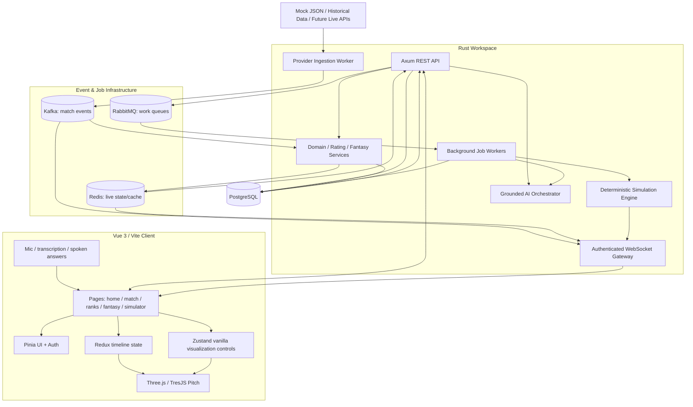
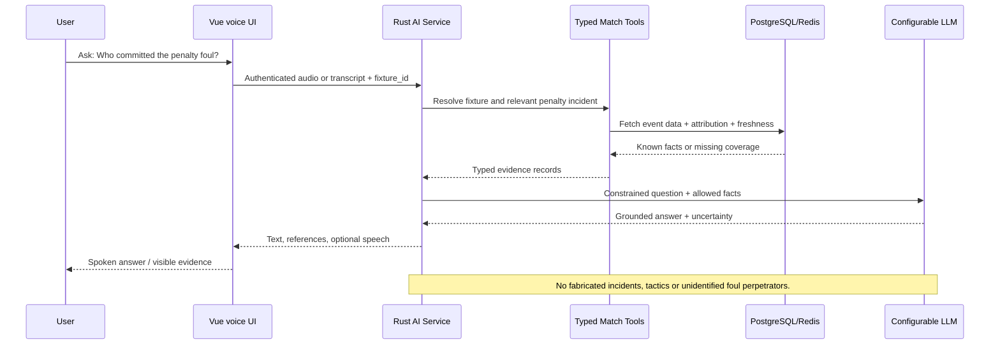
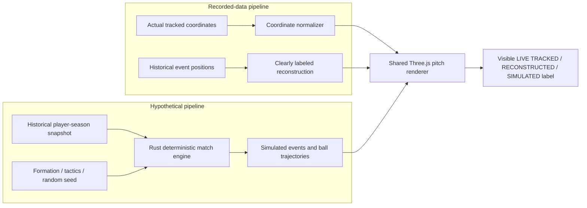
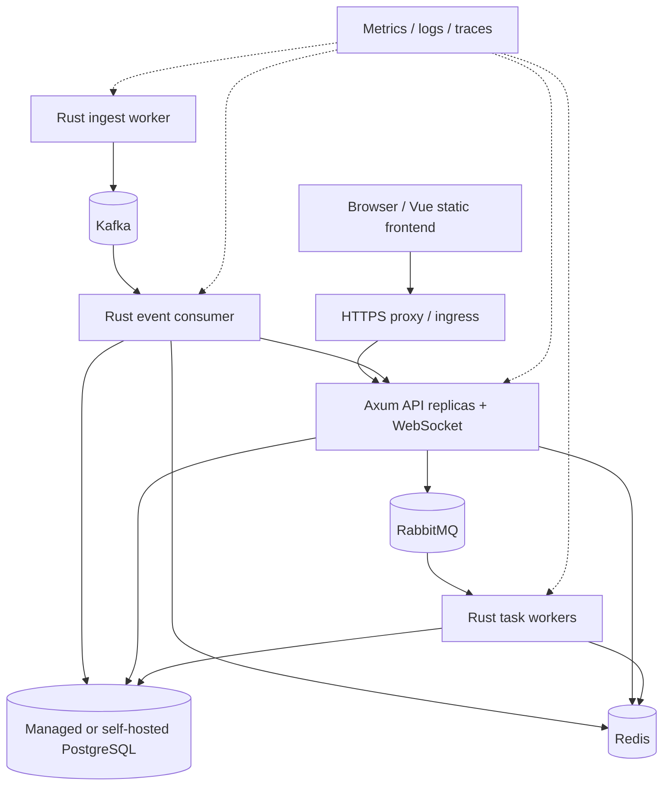

# PitchPulse — Engineering Roadmap

> **Project:** `pitchpulse-football-intelligence`  
> **Product:** PitchPulse — *The Game, Decoded.*  
> **Status:** Greenfield; no implementation is assumed.  
> **Purpose:** Source-of-truth execution plan for Codex and human reviewers. Build one verified vertical slice at a time, from an empty repository to a deployable football intelligence product.

## 0. Rules for Codex (read before every coding session)

1. **Inspect before editing.** Read this roadmap, `docs/ARCHITECTURE.md` (if present), `docs/DECISIONS.md` (if present), the repository tree, package manifests, migrations, and the latest Git status. Never assume a stage is complete because its checkbox is checked; verify it.
2. **Find the first incomplete step** in the Implementation Checklist below whose prerequisites pass. Work on that step only unless the user explicitly requests a different step. Implement its substeps as **complete vertical slices** (data contract → backend → storage/events → UI → tests → docs). Keep changes reviewable.
3. **Do not silently skip blocked work.** If external data, API keys, or paid entitlements are unavailable, implement a tested adapter contract with realistic, clearly labeled, deterministic mock JSON. Record the blocker in `docs/BLOCKERS.md`; do not present mock content as live football.
4. **Keep the stack fixed:** Rust, Axum, Tokio, SQLx, PostgreSQL, Vue 3, TypeScript, Vite, Tailwind, Three.js/TresJS, Kafka, RabbitMQ, Redis, WebSockets, and configurable LLM integration. Prefer Pinia for Vue UI state. Redux Toolkit's framework-neutral store may support deterministic event replay, and Zustand **vanilla** stores may support ephemeral high-frequency simulator controls; do not install React to use these libraries or duplicate ownership of state. Introduce them only with a documented use case and tests.
5. **No invented live facts.** All displayed scores, coordinates, xG, events, transfers, injury statuses, sources, and player values must have data provenance (`live`, `historical`, `reconstructed`, `simulated`, or `mock`). AI explanations cite the data they use and explicitly separate fact from inference.
6. **No false completion.** A step is finished only after its acceptance criteria pass, code compiles, relevant tests pass, docs are updated, and a reviewer can use the end-to-end functionality. Mark only actually completed checkboxes.
7. **After each step:** update the checklist and progress table, `docs/ARCHITECTURE.md`, API schemas, migrations and README as necessary. Report changed files, commands/tests run, demo instructions, known limitations, blockers and **the exact next step**.
8. **Work within the current session.** Do not claim to be running in the background; do not skip validation. If time or tool limits prevent finishing, leave the step unchecked and document partial progress plus the next command to run.
9. **Use official documentation for versions/configuration** when tooling is available; pin tested dependency versions. Do not assume availability of free live ball coordinates.
10. **Security:** never commit tokens or secrets; use `.env.example`. Secure passwords, sessions, WebSocket access, admin actions and user privacy. Do not invent or scrape licensed tracking data.

### Definition of Done — every step

- [ ] Functional backend/domain implementation, not only route scaffolds.
- [ ] Functional Vue UI where the step is user-facing; mobile and keyboard accessible.
- [ ] Persisted data where required, with migrations/indexes and authorization.
- [ ] All external/mock data has provenance, timestamps and capability metadata.
- [ ] Success, loading, empty, offline, missing-data and failure paths are handled.
- [ ] Automated tests cover normal, boundary and error cases; lint/build pass.
- [ ] Documentation and architecture are updated, including deployment and usage implications.
- [ ] Manual demonstration and acceptance criteria verified before step marked complete.

## 1. Product scope

PitchPulse combines **(A)** real/live football coverage, **(B)** interactive match intelligence and voice Q&A, **(C)** a pitch visualizer with a moving ball, **(D)** explainable position-specific player ratings and scouting, **(E)** cross-era dream-team simulation, and **(F)** two non-monetary fantasy modes. It also provides football news, transfer tracking, favourite clubs/players, notifications, profiles and leaderboards.

**Critical product distinction:** *Recorded playback*, *event-based reconstruction*, and *hypothetical simulation* are different data modes. They may share one renderer but never share misleading labels or fabricated movement.

### Required top-level navigation

Home · Live Matches · Competitions · Clubs · Players · Rankings · AI Analyst · Tactical Lab · Dream Simulator · Fantasy · News · Transfers. Include global search, following/favourites, alerts, account menu; responsive navigation on mobile.

### Required route families

| Area | Representative routes |
|---|---|
| Home / matches | `/`, `/live`, `/matches`, `/matches/:fixtureId`, `/matches/:fixtureId/pitch` |
| Football catalogue | `/competitions`, `/competitions/:id`, `/competitions/:id/standings`, `/clubs/:id`, `/players/:id`, `/search` |
| Rankings and intelligence | `/rankings`, `/rankings/players`, `/rankings/:position`, `/lab/tactics`, `/lab/time-machine`, `/scout`, `/ai/matches/:fixtureId` |
| Simulator | `/simulator`, `/simulator/build`, `/simulator/runs/:id`, `/simulator/runs/:id/replay` |
| Fantasy | `/fantasy/season`, `/fantasy/season/:id`, `/fantasy/predictions`, `/fantasy/leaderboards` |
| Community | `/news`, `/news/:id`, `/transfers`, `/transfers/confirmed`, `/transfers/rumours`, `/profile/:username`, `/settings`, `/notifications`, `/login`, `/register` |

**Homepage sections:** featured fixture, today/live matches, upcoming fixtures, recent results, followed clubs, competition tables, top scorers/assists, player of the week, rankings, AI match insights, tactical analyses, fantasy leaderboards, simulator showcase, latest news, confirmed transfers and attributed rumours, on-this-day historical features. Every section must have meaningful click-through and honest empty states.

## 2. Technical decisions and responsibilities

| System | Responsibility | Source of truth |
|---|---|---|
| Vue 3 + TS + Vite + Tailwind | Fast responsive site, charts, searches, forms, match dashboard | REST/WebSocket state |
| Three.js + TresJS | Pitch, ball and tactical visualizations; subtle 3D site effects | Normalized tracking/replay/simulation events |
| Pinia | Session, preferences, favourites, UI filters | Backend data via API |
| Redux Toolkit (framework-neutral) | Optional replayable timeline reducers with deterministic events | Match event log |
| Zustand vanilla | Optional high-frequency local control state (camera/editor) | Ephemeral browser state |
| Rust + Axum + Tokio | Versioned REST and WebSocket gateway; domain/services | PostgreSQL and read models |
| SQLx + PostgreSQL | Players, seasons, fixtures, history, fantasy, simulation, users | Canonical durable records |
| Kafka | Ordered-by-key event ingest/replay and fan-out | Normalized immutable event envelopes |
| Redis | Cache, live fixture snapshot, rate limits, leaderboard acceleration | Rebuildable from PostgreSQL/events |
| RabbitMQ | Work dispatch (AI jobs, reports, simulations, notifications, settlement) | Jobs + durable outcome records |
| LLM + RAG/tool calls | Grounded match QA, scouting, tactical narratives | Authorized fixture/stat/source data |
| Provider adapters | Mock JSON, public historical sources, later commercial APIs | Provider-normalized contract |

### 2.1 Component architecture



### 2.2 Live-event delivery with correction and replay

```mermaid
sequenceDiagram
    participant Source as Mock/Provider
    participant Ingest as Rust Ingestor
    participant Kafka
    participant Persist as Event Consumer
    participant DB as PostgreSQL
    participant Cache as Redis
    participant WS as WebSocket
    participant Vue as Vue Match Center
    Source->>Ingest: Event / fixture snapshot
    Ingest->>Ingest: Normalize, timestamp, deduplicate, validate
    Ingest->>Kafka: Event keyed by fixture_id
    Kafka->>Persist: Consume event (at-least-once)
    Persist->>DB: Idempotent upsert and audit log
    Persist->>Cache: Update read model
    Persist->>WS: Publish new state sequence
    WS->>Vue: Snapshot/delta with sequence number
    Vue-->>WS: Reconnect with last seen sequence
    WS->>Cache: Retrieve current snapshot
    WS->>Vue: Reconcile missed state
    Note over Source,Vue: Updates can be corrected or delayed; never imply video-grade tracking from sparse observations.
```

### 2.3 Voice question and answer pipeline



### 2.4 Simulation vs factual playback



### 2.5 Deployment topology



**Realism / deployment warning:** A cloud host must support persistent Rust HTTP/WebSocket services and separate workers. Vercel may host the Vue static frontend, but do not assume it can host the entire Kafka/RabbitMQ/long-running Rust system. Determine hosting cost and persistence before enabling production ingestion.

### 2.6 Detailed diagrams to maintain

Maintain `docs/architecture/` with separate editable Mermaid files for (1) frontend/stores, (2) domain/modules, (3) database ERD, (4) Kafka topics/consumer groups, (5) RabbitMQ exchanges/queues, (6) API/WebSocket protocol, (7) tracking normalizer/renderer, (8) AI QA, (9) simulator, (10) fantasy scoring, and (11) deployment. Update them when implementation changes; diagrams are not a substitute for functioning code.

## 3. Monorepo structure (target; adapt carefully as work evolves)

```text
pitchpulse-football-intelligence/
├── apps/
│   ├── web/                 # Vue 3 + TS + Vite + Tailwind + TresJS
│   ├── api/                 # Axum REST/WebSocket executable
│   ├── ingest-worker/       # External/mock provider ingestion
│   ├── event-consumer/      # Kafka consumers: persistence, cache, updates
│   └── job-worker/          # RabbitMQ jobs
├── crates/
│   ├── domain/              # Strongly typed football and user entities
│   ├── application/         # Use cases / business services
│   ├── persistence/         # SQLx repositories and transactions
│   ├── providers/           # Normalized adapters for all sources
│   ├── events/              # Versioned Kafka + WebSocket contracts
│   ├── rating-engine/       # Position- and minutes-aware scoring
│   ├── simulation-engine/   # Seeded football simulation
│   ├── fantasy-engine/      # Scoring and settlement rules
│   ├── ai-orchestrator/     # Tool-based grounded match QA
│   └── shared/              # Common errors/config/telemetry
├── database/migrations/
├── data/mock/
│   ├── competitions.json
│   ├── clubs.json
│   ├── players.json
│   ├── player_seasons.json
│   ├── fixtures.json
│   ├── lineups.json
│   ├── events/
│   ├── tracking/
│   ├── news.json
│   ├── transfers.json
│   └── fantasy/
├── docs/
│   ├── ARCHITECTURE.md
│   ├── DECISIONS.md
│   ├── BLOCKERS.md
│   ├── architecture/
│   ├── api/
│   ├── data-contracts/
│   └── runbooks/
├── infra/                   # Docker, Kafka, RabbitMQ, observability
├── .github/workflows/
├── .env.example
├── docker-compose.yml
├── Cargo.toml
├── pnpm-workspace.yaml
├── ROADMAP.md
└── README.md
```

## 4. Data contracts and provider-agnostic development

**Architecture rule:** Provider-specific JSON is transformed into a stable internal schema; API routes, analytics, WebSockets and renderers consume the stable schema, never vendor-specific raw fields.

### 4.1 Minimum canonical fixture event

```json
{
  "schema_version": 1,
  "event_id": "match-001-event-00034",
  "fixture_id": "match-001",
  "provider": "mock",
  "data_mode": "mock",
  "event_type": "goal",
  "period": 1,
  "clock_ms": 2850000,
  "team_id": "team-home",
  "player_id": "player-09",
  "related_player_id": "player-10",
  "occurred_at": "2026-10-26T12:47:30Z",
  "received_at": "2026-10-26T12:47:31Z",
  "revision": 1,
  "payload": {"score_home": 1, "score_away": 0}
}
```

### 4.2 Minimum tracking sample

```json
{
  "schema_version": 1,
  "fixture_id": "match-001",
  "provider": "mock",
  "data_mode": "simulated",
  "period": 1,
  "clock_ms": 2850000,
  "pitch_coordinates": {"x": 0.62, "y": 0.41},
  "sampled_at": "2026-10-26T12:47:30Z",
  "confidence": null
}
```

Coordinate conventions: normalized `x`, `y` in `[0,1]`, with a documented home-to-away attack direction **per period**. Record vendor conventions on input; invert/rotate only in the normalization adapter. Sparse data may be visually interpolated, but never described as continuous measured tracking.

### 4.3 Mock data quality gates

- Provide realistic **fictional** clubs, players and match IDs in default demo datasets to avoid fabricating real-club results. Historical open datasets may use real IDs only with authorization and attribution.
- Include at least: 2 competitions, 8 clubs, 100+ player-season records, 20 fixtures, 2 full event-replay fixtures, 1 tracking file, goal/penalty/card/VAR/substitution corrections, and 1 mock fantasy gameweek.
- Validate JSON via versioned schemas/typed Rust deserialization; deterministic clock and seed; no `Math.random`-based changing results in UI components.
- Each fixture declares capabilities such as `has_lineups`, `has_xg`, `has_tracking`, `has_foul_player`, and `is_reconstruction`.
- Expose demo mode prominently (`DEMO DATA`); do not show invented news or transfers as factual.
- Provider adapters implement fixture, team, player, event, statistics, tracking, news and transfer interfaces; enforce capability checks before using advanced features.

## 5. Data model (initial baseline, expand with migrations)

- **Identity:** users, sessions, user_preferences, followed_clubs, followed_players, notification_preferences.
- **Football:** countries, competitions, seasons, stages, clubs, club_seasons, players, player_seasons, player_club_memberships, fixtures, fixture_participants, fixture_events, lineups, team_stats, player_stats, tracking_samples, provider_mappings, provider_coverage.
- **Ratings:** rating_models, rating_versions, player_match_ratings, player_season_ratings, rating_explanations, rating_coverage.
- **Fantasy:** fantasy_seasons, leagues, memberships, fantasy_squads, fantasy_rosters, transfers, lineup_locks, fantasy_point_events, fantasy_settlements, prediction_contests, predictions, scoring_rules, leaderboards.
- **Simulation:** simulation_teams, selected_player_seasons, tactics, simulation_runs, seeds, simulation_events, simulation_results, engine_versions.
- **Community:** news_source_links, news_metadata, transfer_claims, discussion_threads, posts, moderation_reports, notifications.
- **Operations:** ingest_checkpoints, idempotency_keys, event_outbox, background_job_records, provider_rate_limits.

Use typed relationships, constraints, SQLx migrations, transactions, appropriate indexes, carefully scoped JSONB payloads, and well-defined data-retention policies. PostgreSQL is canonical; Redis is rebuildable.

## 6. Milestone checklist and progress

> The percent is **planned feature-scope coverage**, not measured hours or effort. Update status only after acceptance criteria pass. If a step is in progress, keep it unchecked and note progress below.

| Step | Name | Planned cumulative coverage | Status |
|---|---|---:|---|
| 01 | Environment & prerequisites | 3% | Not started |
| 02 | Rust/Vue workspace and Docker infrastructure | 7% | Not started |
| 03 | Stadium Noir design system and Three.js shell | 11% | Not started |
| 04 | PostgreSQL schema, migrations and domain model | 15% | Not started |
| 05 | Axum API, auth, profile and OpenAPI | 20% | Not started |
| 06 | Mock JSON providers, replay and normalization | 25% | Not started |
| 07 | Competitions, clubs, players and global search | 30% | Not started |
| 08 | Homepage, fixtures and complete Match Center | 35% | Not started |
| 09 | Kafka ingestion, consumers and replay | 40% | Not started |
| 10 | Redis live state, WebSockets and reconciliation | 45% | Not started |
| 11 | Three.js pitch and tracked/reconstructed ball animation | 50% | Not started |
| 12 | Contextual player ratings and rankings | 55% | Not started |
| 13 | Grounded live AI text + voice analyst | 60% | Not started |
| 14 | Player comparisons and historical Time Machine | 64% | Not started |
| 15 | AI Scout and tactical intelligence | 68% | Not started |
| 16 | Dream-team editor and deterministic simulator | 74% | Not started |
| 17 | Animated simulation playback and result lab | 78% | Not started |
| 18 | Season fantasy with real/mock scoring | 83% | Not started |
| 19 | Matchday prediction fantasy and leaderboards | 87% | Not started |
| 20 | News, transfers, notifications and community | 91% | Not started |
| 21 | RabbitMQ workers, retries and resilience | 94% | Not started |
| 22 | Final motion design, accessibility and responsive polish | 96% | Not started |
| 23 | Security, E2E testing, load tests and observability | 98% | Not started |
| 24 | Production deployment and portfolio documentation | 100% | Not started |

**Current step:** 01 — Environment & prerequisites  
**Last verified completed step:** None  
**Last updated:** 2026-10-29  
**Outstanding blockers:** None recorded; live ball-coordinate provider access is **not required** for development.

---

## 7. Detailed implementation steps

### [ ] Step 01 — Environment and prerequisites (3%)

**Goal:** A reproducible local developer setup from an empty folder.

1. Install/verify Rust toolchain via rustup (`cargo`, `rustc`, `rustfmt`, `clippy`, `rust-analyzer`).
2. Install/verify supported Node.js LTS, `pnpm` via Corepack (or documented version pin), Git/GitHub CLI, Docker Desktop/Engine + Compose.
3. Install/verify PostgreSQL client tools, an optional DB GUI, and editor extensions for Rust/Vue/Tailwind.
4. Set repository name to `pitchpulse-football-intelligence`, establish `main`, add `.gitignore`, `.editorconfig`, license decision, `.env.example`, initial README.
5. Document Mac/Linux/Windows installation differences, version checks and common setup issues; never include personal machine paths or secrets.
6. Add `scripts/check-prerequisites` for version/availability diagnostics.

**Deliverables:** Repository scaffold, setup instructions, prerequisite checker.  
**Verification:** Fresh-machine checklist runs, Git repository clean, no secrets committed.  
**What works:** Developers can reliably begin local development.

### [ ] Step 02 — Monorepo and local infrastructure (7%)

1. Initialize Cargo workspace with Axum API, ingestion/event/job worker executables and shared crates; pin compatible dependencies.
2. Scaffold Vue 3 + TypeScript + Vite; add Vue Router, Tailwind, Pinia, lint/typecheck/test tooling.
3. Add Docker Compose for PostgreSQL, Redis, Kafka (one-node dev mode), RabbitMQ and optional admin UIs; health checks and named volumes.
4. Create API config loader, tracing, common errors, timeouts, graceful shutdown and health/readiness endpoints.
5. Add CORS for documented local origins, frontend `.env.example`, health-fetch example and one working API route.
6. Add development scripts and CI: `cargo fmt`, `cargo clippy`, `cargo test`, web lint/typecheck/build.
7. Record startup prerequisites, ports and service dependencies.

**Verification:** `docker compose up -d`; Rust API `/health` returns OK; Vue page fetches it; CI checks succeed.  
**What works:** The entire basic stack starts locally and communicates.

### [ ] Step 03 — Stadium Noir design system and 3D application shell (11%)

1. Establish brand tokens: background `#0A1519`, surface `#17282D`, lime `#BCFF63`, cyan `#62E0F0`, coral `#FF9786`, ice white `#F5FFF5`; define states, type scales and contrast rules.
2. Implement reusable accessible card, button, modal, nav, chart wrapper, table, loader, error state, tooltip and match score components.
3. Build responsive header/navigation, mobile bottom nav, global search shell, footer, route transitions and page layouts.
4. Integrate Three.js/TresJS for **subtle football-themed** hero visuals (pitch lines, controlled lighting/parallax); no floating football cursor, no gamey landing gimmicks.
5. Add responsive image handling, reduced motion, no-WebGL fallback, frame/performance budgets and lazy scene loading.
6. Build homepage skeleton for required sections; label placeholder sections `DEMO` until connected.

**Verification:** Desktop/tablet/mobile checks; keyboard navigation; reduced-motion fallback; baseline rendering metrics recorded.  
**What works:** Distinctive responsive branded app shell.

### [ ] Step 04 — PostgreSQL foundation and domain schema (15%)

1. Model competitions, seasons, stages, clubs, players, memberships, fixtures, events, lineups, team/player stats, coverage flags, and provider mappings.
2. Add users/sessions/preferences and baseline placeholders for future ratings, simulation, fantasy and community tables.
3. Implement typed Rust domain IDs, SQLx repositories, transactional migrations, seed scripts and indexes.
4. Normalize timezone and timestamps (UTC in storage), season IDs, match periods and event correction revisions.
5. Define idempotency and outbox concepts for later Kafka integration; avoid dual-write race conditions.
6. Create `docs/architecture/database.mmd` ERD and initial migration tests.

**Verification:** Fresh DB → migrate → seed → query → rollback/recreate successfully.  
**What works:** Durable coherent football data model.

### [ ] Step 05 — Rust REST API and authentication (20%)

1. Implement Axum routing, handler/service/repository separation, JSON DTOs, validation, pagination, error codes and OpenAPI.
2. Implement registration, login/logout, Argon2id password hashing, secure sessions or well-designed JWT refresh, protected routes and rate limiting.
3. Add `/users/me`, settings, followed teams, favourite players and profile preferences.
4. Create auth UI (login/register/settings) and connect to the backend; protect private routes and WebSocket credentials.
5. Test expired sessions, unauthorized access, duplicate usernames, password validation and SQL safety.
6. Add API versioning `/api/v1` and consistent response envelopes.

**Verification:** User registration, login, preference update and logout work end-to-end and survive refresh.  
**What works:** Real accounts, secured REST endpoints and API documentation.

### [ ] Step 06 — Mock JSON provider abstraction and replay system (25%)

1. Define provider traits for competitions, fixtures, lineup, stats, tracking, news and transfers; use typed provider capability metadata.
2. Implement `MockFootballProvider` reading **versioned** JSON files in `data/mock`; no UI hardcoded arrays.
3. Seed fictional but internally consistent leagues, clubs, players, fixtures, lineups, events, goals, substitutions, penalties, cards, corrections, news and transfers.
4. Build deterministic virtual match clock (pause, speed, seek, resume) and ordered event emitter; store replay seed.
5. Build provider normalization, revision handling, data provenance (`mock`, `historical`, `live`, `reconstructed`, `simulated`), timestamps, coordinate convention and per-field coverage.
6. Create provider contract tests; allow selecting providers with a config flag (mock default, real adapters disabled until configured).
7. Document licensing/attribution and **never** present seeded news/scores as factual current events.

**Verification:** Replaying a mock fixture emits a coherent goal, penalty, substitution and end-of-match state; clients receive a stable domain shape.  
**What works:** Paid API independence with realistic, repeatable football data.

### [ ] Step 07 — Competitions, clubs, players and global search (30%)

1. Build list/detail APIs for competitions, standings, clubs, squads, player histories and available statistics.
2. Implement basic football search for player/team/competition with stable filtering, pagination and URL query parameters.
3. Create Vue pages, dynamic routing, club crests/assets (owned demo assets), player profiles and normalized historical memberships.
4. Implement sorting, loading/empty/error states, favourite actions, mobile tables and cross-linked records.
5. Add route tests and paginated database query tests; document data freshness and mock status.

**Verification:** Browse league → team → player → season, with all relations correct.  
**What works:** Searchable football encyclopedia foundation.

### [ ] Step 08 — Homepage, fixtures and full Match Center (35%)

1. Populate homepage with match-of-day, fixtures, results, tables, scorers, rankings previews, AI/simulator previews, transfers and news previews.
2. Implement `/live`, fixtures by date, competition-specific schedules, match cards and statuses.
3. Build fixture detail with Overview, Timeline, Lineups, Statistics, Player Ratings (pending model), AI Analyst (pending), Pitch (pending), H2H and Predictions (pending).
4. Implement goals, assists, cards, substitutions, penalty and VAR event representations; use source capability flags for unavailable detail.
5. Handle postponements, timezones, first/second half, added time, match corrections and empty/missing stats.
6. Build mobile-friendly scorecards, event accordions and readable graphs.

**Verification:** Seeded fixture opens a coherent Match Center with sourced event history and current score.  
**What works:** A functional football scores and information website before advanced messaging.

### [ ] Step 09 — Kafka ingestion and event replay (40%)

1. Define versioned event envelope fields: event ID, fixture ID, period, clock, source event ID, revision, received time and source.
2. Implement ingest worker converting mock/provider updates to normalized Kafka topics partitioned by fixture ID.
3. Topics: `football.fixtures.updated`, `football.match.events`, `football.match.statistics`, `football.match.tracking`, `football.ratings.calculated`, `football.fantasy.settled` (create when consumers exist).
4. Add persistence/read-model consumers with idempotent upserts, checkpointing, deduplication, correction and deletion policies.
5. Apply outbox or an equivalently reliable event-publishing boundary to protect PostgreSQL/event consistency.
6. Implement replay from retained events and deterministic rebuild of fixture snapshots; define retention and partition ordering.
7. Test duplicate, reordered, cancelled and revised events; instrument lag and failures.

**Verification:** Replay mock match into Kafka; consumers persist correct final state without duplicate goals.  
**What works:** Durable match event stream and auditable event-driven backend.

### [ ] Step 10 — Redis live read model, WebSockets and recovery (45%)

1. Build a Redis cache for active fixture snapshots with timestamps, version and TTL; PostgreSQL/event stream retains canonical history.
2. Add fixture-scoped authenticated/public WebSocket channels as appropriate; publish only processed, committed updates.
3. Implement frontend connection manager, heartbeat, reconnect, last-seen event cursors and snapshot reconciliation.
4. Live-update scores, match clock, cards, timeline and available stats without reload; prevent duplicate UI events.
5. Provide polling fallback, disconnection/offline states and stale-data indicators.
6. Test consumer restart, gateway restart, reconnect under missing messages, slow clients and Redis loss/rebuild.

**Verification:** Event producer changes visible match state on multiple browsers; reconnection restores correct state.  
**What works:** Real-time-feeling fixture updates driven by the mock event stream.

### [ ] Step 11 — Animated ball tracking and Three.js live pitch (50%)

1. Create accurate pitch coordinates, field markings and performant Three.js/TresJS scene with top-down/isometric camera modes.
2. Implement a shared pitch renderer accepting one of three **explicit** modes: actual tracked points, approximate reconstruction, generated simulation.
3. Normalize vendor pitch direction and coordinate scales; sync samples to fixture clock; handle halftime side switching.
4. Interpolate positions with latency awareness, stopping when observations are missing; do not pretend interpolated points are measured.
5. Connect live replay stream; draw ball, trailing paths, event markers and uncertainty; no animated humanoid player requirement.
6. Implement pause/seek/speed/fullscreen, accessible 2D canvas fallback, reduced motion, touch/pointer camera controls.
7. Introduce Redux Toolkit reducer for deterministic event-replay controls and Zustand **vanilla** only if needed for high-frequency transient scene control, with Vue adapter tests.
8. Profile FPS, memory and low-end device fallback.

**Verification:** Mock tracking stream moves ball with the match clock; mode/provenance labels are visible; seek/replay deterministic.  
**What works:** Signature ball movement pitch visualizer without paid tracking API.

### [ ] Step 12 — Position-aware ratings and rankings (55%)

1. Implement separate Rust `rating-engine` profiles for forwards, wide attackers, midfielders, defenders and goalkeepers.
2. Combine goals, assists, chance creation, passing, progression, dribbling, recoveries, defending, saves, discipline and contextual evidence **only when covered by data**.
3. Normalize contributions by playing time while applying small-sample shrinkage, participation thresholds, reliability indicators and positional weighting.
4. Preserve a clear mathematical formula, version/weights, input coverage and explanation breakdown per result.
5. Calculate match/season ratings and position-relative rankings; provide sortable/filterable `/rankings` pages.
6. Benchmark a 90-minute hat-trick versus a highly effective ten-minute substitute without assuming either automatically wins; compare data availability and confidence.
7. Add tests for edge cases, missing xG, minimal minutes, duplicates, red cards and keeper-specific inputs.

**Verification:** Stable ratings from seeded match stats, reproducible formula and explanation, uncertainty shown.  
**What works:** Proprietary but transparent PitchPulse rating engine.

### [ ] Step 13 — Grounded AI text and voice match analyst (60%)

1. Implement typed tool calls for fixture, goals, penalty incidents, substitutions, possession, statistics and source freshness.
2. Text Q&A first: contextual question → validated tool arguments → retrieved match evidence → evidence-grounded response.
3. Add conversational continuity scoped to active fixture; store only consented conversation history and apply privacy limits.
4. Introduce mic push-to-talk, speech-to-text and text-to-speech via configured official speech provider; secure tokens and audio access.
5. Include response evidence, match timestamp and uncertainty; never invent fouling players or tactical causes without supporting data.
6. Offer deterministic non-LLM fact lookup if provider/LLM unavailable; label fallback and distinguish inference.
7. Implement token/cost ceilings, latency controls, cancel/interrupt speech, rate limiting, prompt-injection checks and evaluation fixtures.
8. Test user questions: how goal scored with less possession; who committed penalty foul; why deep defending (inference); what changed after substitution (correlation caveat).

**Verification:** Text question and mic question both return factual, grounded answers for mock fixtures, spoken when configured.  
**What works:** Conversational match assistant, not simply autogenerated commentary.

### [ ] Step 14 — Player comparisons and historical Time Machine (64%)

1. Add historical player-season snapshots and team-season lineups with explicit availability/coverage.
2. Create `/lab/time-machine` and side-by-side comparisons across players/teams/years.
3. Compare totals, per-90 figures, availability, competitions and appropriately qualified era context.
4. Add chart visualizations, save/share comparison, filters by role/season and missing-data explanations.
5. Never copy modern player abilities into old years; support only real licensed historical or labeled demo snapshots.
6. Test calculations across different minute totals and incomplete seasons.

**Verification:** User compares two historical snapshots accurately and sees evidence gaps.  
**What works:** Cross-era football comparison lab.

### [ ] Step 15 — AI Scout and tactical analysis (68%)

1. Build typed scouting search from natural-language input to parameterized SQLx filters; enforce allowlisted sort/metrics.
2. Support age, position, foot, league, season, minutes, per-90 statistics, scouting similarity and sourced attributes.
3. Rank candidates with transparent reasons and supporting recorded data; do not fabricate valuations or player characteristics.
4. Add tactical views (formation, available event maps, passes, pressure where sourced), explicit inference/certainty labels.
5. Build saved shortlists, side-by-side scouting comparisons and AI narratives via grounded tools.
6. Benchmark common searches, verify SQL safety and demonstrate fallback when AI is unavailable.

**Verification:** "Left-footed midfielder under 23 with strong progression" returns only matching seeded players, with evidence.  
**What works:** Searchable AI-driven football scouting and tactical lab.

### [ ] Step 16 — Dream-team creator and deterministic Rust simulation engine (74%)

1. Create builder selecting current or historical player-season snapshots, starting XI, bench, formation and player roles.
2. Implement drag/drop pitch editor, tactic sliders (tempo, press, width, defensive line, build-up, counterattack), roster validation.
3. Implement Rust probabilistic/discrete-event simulation: possession, passes, shots, xG estimates, goals, fouls, saves, stamina, substitutions, cards and match end.
4. Require stable seed + engine version + roster/tactics snapshot for reproducible outcomes; store all outputs with `simulated` provenance.
5. Add quick simulation and full 90-minute simulation; optional extra time/penalties based on match rules.
6. Expose job-based APIs, run status, progress, results and failure recovery; store full simulated event log.
7. Test impossible lineups, minute constraints, determinism, goal accounting and fairness distributions.

**Verification:** Custom mixed-era XI vs historical XI produces repeatable events and result with same seed.  
**What works:** Fully functional Rust dream-match engine and editor.

### [ ] Step 17 — Simulation pitch playback and result explorer (78%)

1. Reuse Step 11 pitch scene for **generated simulation** ball trajectories and tactical markers.
2. Render simulated passing, shots, goals and position transitions consistently with event timestamps.
3. Add variable-speed playback, scrub, goal highlights, pause/rewind and camera controls.
4. Present score, simulated ratings, stats, event timeline, formations and substitution effects.
5. Add deterministic rematch, best-of-N / Monte Carlo aggregate outcomes with distribution charts and model assumptions.
6. Support saved/shareable runs, permissions and standalone result URLs; label entire experience simulated.

**Verification:** User builds a team, runs a game, watches ball movement and shares a replay that loads correctly.  
**What works:** Complete dream football experience, clearly hypothetical.

### [ ] Step 18 — Season-long fantasy football (83%)

1. Create fantasy competition seasons with explicit scope, dates, rounds, eligible fixtures, player pools and versioned scoring rules.
2. Implement budgets, roster constraints, captain/vice-captain, lineups, transfers and locked deadlines enforced by server time.
3. Create fantasy leagues (public/private), invitations, week and season standings.
4. Calculate score-event ledger from verified match stats or **labeled mock fixtures**; never score non-existent events.
5. Reconcile post-match corrections, deduplicate point events and preserve scoring audit trail.
6. Add frontend draft/team builder, gameweek summary and scoring breakdown; test changing captains after deadline.

**Verification:** Multiple users draft teams and complete a seeded gameweek with correct points and rankings.  
**What works:** First fantasy mode, season-long squad management.

### [ ] Step 19 — Matchday predictions fantasy and leaderboards (87%)

1. Build prediction contests and entries for score, outcome, first goalscorer, player of match and available events.
2. Configure additive/non-additive points clearly; lock predictions by fixture kickoff in server UTC.
3. Settle predictions idempotently from final verified fixture result; track source revision and correction rescoring.
4. Add global, weekly, matchday, friend and season leaderboards, audit view and tie-breaking policy.
5. Add streaks and achievements as non-monetary engagement; no wagering or real-money rewards.
6. Test pre/post-lock edits, delayed fixtures, abandoned matches, correction events and cheating attempts.

**Verification:** A prediction entered before kickoff receives exactly the configured points after fixture finalization.  
**What works:** Second fantasy mode, prediction leaderboard competitions.

### [ ] Step 20 — News, transfers, notifications and community (91%)

1. Add `FootballNewsProvider` and `TransferProvider` adapters (mock development, licensed source later); store source link, article metadata, claim status, published time.
2. News routes: latest, club, competition, player, article external link; no unauthorized copyrighted full-text mirroring.
3. Transfer Center: rumours, reported talks, confirmed deals, loan/extension/free transfer with dated attribution.
4. Add followed club/player alerts, optional match kickoffs, goals, final whistles and fantasy deadlines.
5. Implement community profiles, discussion threads, match polls, shared simulations, comment moderation/reporting.
6. Handle real vs fake claims with prominent demo-mode labels; no invented headlines on a production live feed.
7. Test alerts duplication, privacy, blocked users, moderations and source provenance.

**Verification:** News and transfers render from mock source with source labels; follow and community actions persist.  
**What works:** Broad football media and social experience.

### [ ] Step 21 — RabbitMQ jobs, retries and resilient processing (94%)

1. Integrate RabbitMQ across AI reports, simulation runs, fantasy settlement, notification dispatch and ingest reconciliation jobs.
2. Set up durable exchanges/queues with versioned payloads and stable job IDs, bounded retries, exponential backoff and DLQs.
3. Implement worker acknowledgements after durable side effects, idempotent handlers, concurrency controls and poison-message handling.
4. Implement job state endpoints and visible progress/retry behavior in Vue.
5. Add orchestration tests for worker crash mid-job, broker outage, repeated delivery and graceful shutdown.
6. Document Kafka vs RabbitMQ roles and failure/recovery runbooks; instrument queue depth.

**Verification:** Simulation and notification jobs survive process restart and do not duplicate state or points.  
**What works:** Reliable asynchronous infrastructure, not just running containers.

### [ ] Step 22 — Visual polish, responsiveness and performance (96%)

1. Audit all pages for Stadium Noir design consistency, accessible contrasts and precise mobile layout.
2. Refine Three.js pitch visuals, clear labels, smooth transitions, subtle pointer effects and no gimmicky cursor-following balls.
3. Optimize bundle splitting, image loading, virtualized long lists, animation frame pacing and WebGL memory.
4. Polish AI voice UX, score timelines, fantasy editor, simulator, cards, toasts, empty/loading/offline states.
5. Test with keyboard-only navigation, screen readers, reduced motion, poor network and low-power hardware.
6. Add SEO basics, sitemap where appropriate, meaningful title metadata and well-designed 404/error pages.

**Verification:** Full UX checklist passes on desktop/tablet/mobile; 3D fallback and 2D mode remain functional.  
**What works:** Professional, premium product interface.

### [ ] Step 23 — Security, tests, performance and observability (98%)

1. Run `cargo fmt/clippy/test`, SQLx migration tests, Vue lint/typecheck, Vitest and Playwright E2E flows.
2. Test auth/permissions, SQL injection defenses, WebSocket origin/access, secrets, rate limits, AI prompt injection and public text moderation.
3. Load test concurrent Match Center subscribers, fixture bursts, Redis cache degradation and Kafka consumer lag.
4. Add metrics/traces/logs for API latency, Postgres queries, Kafka lag, RabbitMQ retries, Redis hit rate, WebSocket health, AI latency/cost and simulation CPU.
5. Verify fantasy scoring/prediction settlements after corrections and simulator statistical properties with seeded inputs.
6. Validate deployment data classification, private data protection, backups, restoration and provenance.
7. Record known production limits and unresolved data-provider blockers.

**Verification:** CI green, end-to-end critical paths pass, load-test summary documented, high-risk issues resolved.  
**What works:** Release candidate with observable, tested behavior.

### [ ] Step 24 — Deployment, CI/CD, demo and portfolio documentation (100%)

1. Create production Dockerfiles, env templates, migration procedures, health/readiness checks and startup order.
2. Deploy Vue static frontend (Vercel or equivalent), Rust API/WebSocket service, ingest and jobs on long-running container hosting.
3. Provision persistent PostgreSQL, Redis, Kafka and RabbitMQ with backups/credential isolation; evaluate costs realistically.
4. Configure HTTPS/TLS, restricted CORS, secrets, monitoring, logging and alerts.
5. Add CI/CD with build/test gates, migration strategy, staged rollout and rollback instructions.
6. Deploy a public **DEMO MODE** with deterministic fictional match data, clear mock labels, and optional live provider via runtime configuration.
7. Write README, current architecture, ADRs, source/data permissions, API docs, local runbooks, screenshots, video/demo script, limitations and portfolio engineering highlights.
8. Run a fresh clone-to-working demo test and live URL smoke tests; save evidence and deployment URLs when real.

**Verification:** Independent reviewer can visit the deployed product, test demo replay/AI/simulator/fantasy, and follow a reproducible local setup.  
**What works:** Complete deployable football intelligence portfolio project.

---

## 8. Recommended developer commands (create/verify during Steps 1–2)

```bash
# Toolchain diagnostic (versions are examples of command usage, not version pins)
rustc --version
cargo --version
node --version
pnpm --version
docker --version
docker compose version

# Once scaffolding exists:
docker compose up -d
cargo fmt --all -- --check
cargo clippy --workspace --all-targets -- -D warnings
cargo test --workspace
pnpm --dir apps/web lint
pnpm --dir apps/web typecheck
pnpm --dir apps/web build
```

Use concrete repo scripts once implemented; do not state commands passed unless executed. Maintain `.env.example` with placeholders only (Postgres, Kafka brokers, RabbitMQ, Redis, provider token, AI key, public frontend/backend origins).

## 9. Architecture and engineering quality gates

**API:** `/api/v1` versioned REST, typed DTOs, pagination, error envelopes, OpenAPI, authentication and authorization. Example endpoints: `/matches`, `/matches/{id}`, `/matches/{id}/events`, `/matches/{id}/tracking`, `/competitions`, `/clubs/{id}`, `/players/{id}`, `/rankings/players`, `/ai/matches/{id}/question`, `/simulations`, `/fantasy/...`, `/news`, `/transfers`. Document all schemas and error codes.

**State:** Persist historical events in PostgreSQL; maintain Redis snapshot with revision and source freshness; WebSocket clients reconcile from a snapshot after reconnect. Kafka at-least-once semantics demand idempotency; don't promise exactly-once end-to-end behavior without implementing it.

**Simulation:** Keep historical fixtures and player-season snapshots immutable enough for repeatability; version algorithms and rules, seed pseudo-randomness, and label generated xG/ball movement and match outcomes as *simulated*.

**Ratings:** A striker with three goals in ninety minutes need not always win over a ten-minute substitute, but per-90 statistics from ten minutes are highly uncertain. Use explicit criteria, confidence/coverage, shrinkage and position-sensitive input weighting. Do not equate model output with objective universal truth.

**Voice AI:** The system must answer match-specific interactive questions via evidence retrieval, not generate continuous fake commentary. Input/audio permissions must be explicit. If a provider doesn't record the fouling player, say so.

**UI:** Theme-related premium site with subtle Three.js—not a game-like landing page. Prefer performance, responsive layout, reduced-motion support and graceful fallback over more particles.

**Fantasy:** Exactly two primary modes: season roster fantasy and matchday prediction fantasy. Each has explicit boundaries, deadlines, points and settlement; no real-money gambling features.

**News/transfers:** No fabricated live headlines or fake confirmations. Display publisher/sources, published dates and rumours as reports, not facts. Respect content licenses.

## 10. Working-session update template (Codex must fill after every step)

```md
### Session update — YYYY-MM-DD
- Target step:
- Verified starting state:
- Implemented substeps:
- Key files changed:
- Migrations/contracts/events added:
- Commands/tests actually executed and outcomes:
- Manual demonstration performed:
- Data mode shown (mock/historical/live/reconstructed/simulated):
- Remaining failures/blockers:
- Architecture/API/docs updated:
- Step status: COMPLETE / IN PROGRESS / BLOCKED
- Next exact step and first action:
```

## 11. Copy-and-use Codex kickoff instruction

> Open `ROADMAP.md` and treat it as the implementation source of truth. Inspect the repository and its Git state, then read `docs/ARCHITECTURE.md` and `docs/BLOCKERS.md` if present. Identify the first incomplete roadmap step, verify prerequisites, and implement **only that step** end-to-end with source code, tests and documentation. Build functional backend/frontend vertical slices, not placeholders. Use deterministic mock JSON as the default provider and label it as demo data; never block core development on a paid football API. Run the relevant checks, document what actually passed, update the roadmap progress and architecture diagrams, and report the next exact step. Do not mark a step complete if its acceptance criteria fail. Continue to the next step only when I explicitly instruct you to proceed or when my session instruction explicitly authorizes sequential execution.

### Optional sequential-session instruction

> Follow `ROADMAP.md` sequentially. After completing and verifying each step, update progress, then proceed to the next step **within the active session and available execution limits**. If a blocker occurs, document it and implement a labeled mock-compatible alternative where the roadmap permits. Never claim asynchronous or background execution.

---

**Product promise:** A complete football intelligence system that can be demonstrated with deterministic mocked match feeds today, while preserving the interfaces required to add licensed live tracking and football APIs later.
